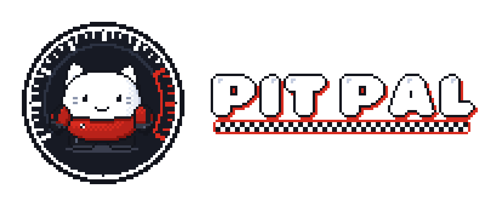
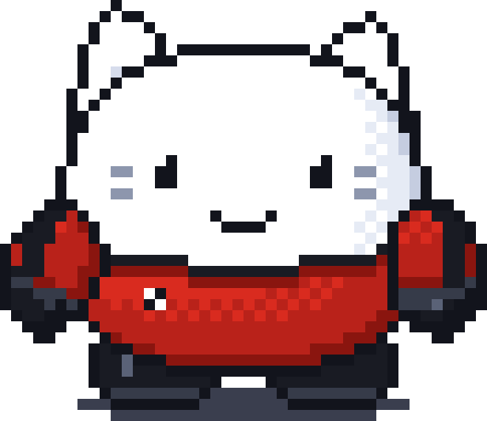
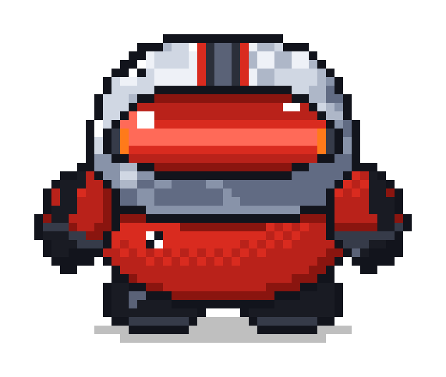
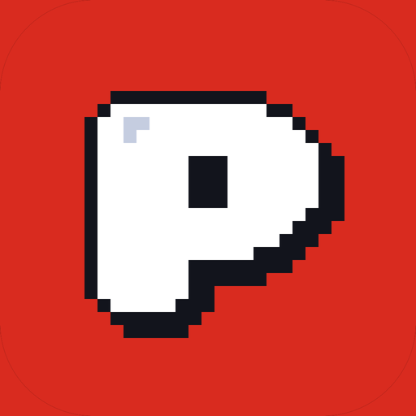

<div align="center">



### Drive better together.

An AI sim-racing coach that sits in the passenger seat. You steer with an iPhone, brake and throttle with homemade
pedals, and a pixel pit-crew mascot called **Rev** watches every corner, tells you one thing to fix, and rewinds
the car so you can try it again. Coaching is written live by **NVIDIA Nemotron**.


&nbsp;&nbsp;


**HackUTD 2026**

[How it works](#how-it-works) · [Meet Rev](#meet-rev) · [The rig](#the-rig) · [Quick start](#quick-start) · [Full reference](docs/REFERENCE.md)

</div>

---

## Why it exists

Practice laps teach nothing if nobody tells you why you were slow. A real coach watches the corner, names the one
mistake that cost the most, and has you try that corner again straight away. Pit Pal does that for Assetto Corsa:
it reads the car live, decides what to fix, says it on the next straight, and puts you back before the corner.

---

## How it works

| Step | What happens |
| --- | --- |
| **Drive** | Steer with the iPhone wheel app, gas and brake with the Arduino pedals (or the phone's on-screen pedals). One receiver turns both into a virtual Xbox pad for the game. |
| **Read** | The coach reads Assetto Corsa's telemetry at 100 Hz and scores every corner: braking point, apex speed, lock-ups, wheelspin, wheels off, time lost. |
| **Decide** | NVIDIA Nemotron (self-hosted on an H100, or NVIDIA's hosted API) writes one specific action for that corner. A validator checks every number against the data; if the model is slow or wrong, a rules coach answers. |
| **Tell** | Rev shows the cue in a speech bubble over the game and the voice says it on the next straight, never mid-corner. |
| **Retry** | Tap **Next** on the phone: the car rewinds to the approach of that corner (rolling checkpoints in a CSP Lua app) and you try it again. |

---

## Meet Rev

Rev sits in the corner of the screen over the game. He shows a pairing QR until your phone connects, puts his helmet
on when you drive, reacts to lock-ups and slides, and shows the coach's cue as a short bubble: what happened in bold,
what to do underneath. The voice carries the rest, so the screen stays clear. Right-click him for the menu,
**Quit Rev** ends the session.

---

## The rig

| Part | What it does |
| --- | --- |
| **iPhone wheel** (`phone/`) | Tilt to steer, paddle shifters, on-screen pedals, the **Next** button for retries, pairing by QR. |
| **Arduino pedals** (`hardware/`) | Two ultrasonic sensors measure pedal position (gas and brake); calibrated on the game PC, with a fail-safe that releases a pedal if its sensor goes quiet. |
| **Game PC** | Assetto Corsa + Content Manager + Custom Shaders Patch, the coach, Rev, and the CSP rewind app (`csp/nomadsim_reset`). |
| **AI** | NVIDIA Nemotron 3.5 Lightning on a Brev H100 (vLLM), or NVIDIA's hosted API; no AI = the rules coach. |

---

## Quick start

On the Windows game PC with Assetto Corsa, Content Manager and Custom Shaders Patch installed:

```powershell
git clone https://github.com/Azrkiel/obsidian-hackutd-2026.git
cd obsidian-hackutd-2026
uv sync --system-certs
.\PitPal.bat
```

Start Assetto Corsa first (borderless or windowed, so Rev can sit on top), then run `PitPal.bat` or the **Pit Pal**
shortcut (`scripts/make_shortcut.ps1`). Scan Rev's QR with the app and drive.

Everything else (the rewind app, the pedals, Nemotron on Brev, pairing, cloud history, troubleshooting) is in
**[PC_SETUP.md](PC_SETUP.md)** and the **[full reference](docs/REFERENCE.md)**.

---

## Demo in 3 minutes

1. Rev appears with a QR code; scan it in the app and he says **Connected.**
2. Drive Monza in the Miata. Brake late into Turn 1.
3. On the straight: *"Rettifilo: you braked 14 m late, 0.4 s lost. Brake at the 100 board."*
4. Tap **Next** on the phone: the car is back before the corner. Try again: **Clean.** or **Not yet.**
5. Floor it out of Lesmo 2: *"Easy on throttle."*

---

## Under the hood

```text
coach/        the coach: telemetry, corner scoring, retry offers, voice, dashboard, phone receiver
engine/       Nemotron decision ladder, validator, rules coach, drills
pitpal/       Rev, the overlay (Tkinter), and the Pit Pal brand assets
phone/        the iPhone wheel app (SwiftUI)
hardware/     Arduino pedal sketch
csp/          the Custom Shaders Patch rewind app (rolling checkpoints)
bridge/       standalone phone + pedals -> virtual pad receiver
scripts/      launch, Brev, Nemotron tunnel, shortcut, retry watcher
spacetime*/   optional shared race history (SpacetimeDB)
docs/         reference, pairing, overlay, history and planning notes
```

Internal names such as `nomadsim_reset` and `nomadsim-engine` are historical and kept on purpose.

---

## Team

| | |
| --- | --- |
| **Keven Diaz** | iPhone app, input receiver, pairing |
| **Kevin Jiang** | engine, Nemotron, voice and history |
| **Dhanush Koyi** | game PC, bridge, CSP rewind app, pedal tuning, Rev overlay |
| **Will Yang** | Arduino pedals |

## Credits

Assetto Corsa belongs to Kunos Simulazioni; NVIDIA, Nemotron, Apple and iPhone belong to their owners. This project
is not affiliated with or endorsed by them. Barlow is licensed under the SIL Open Font License 1.1; the QR encoder in
`coach/qrcodegen.py` is Project Nayuki's (MIT). Rev, the Pit Pal logos and the app icon are the team's brand assets.

<div align="center">



**Pit Pal** · Drive better together.

</div>
