<div align="center">

<picture>
  <source media="(prefers-color-scheme: dark)" srcset="docs/img/banner-wide-dark.png">
  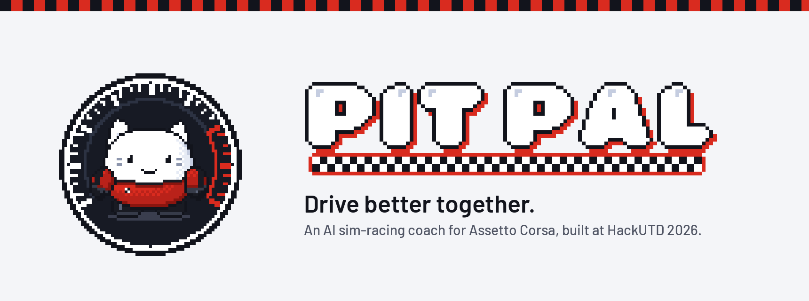
</picture>

### Drive better together.

An AI sim-racing coach that sits in the passenger seat. You steer with an iPhone, brake and throttle with homemade
pedals, and a pixel pit-crew mascot called **Rev** watches every corner, tells you the one thing to fix, and rewinds
the car so you can try it again. The coaching is written live by **NVIDIA Nemotron**.

[](LICENSE)
[](pyproject.toml)
[](#coaching-and-retries)
[](SETUP.md)
[](https://github.com/Azrkiel/obsidian-hackutd-2026)

**[github.com/Azrkiel/obsidian-hackutd-2026](https://github.com/Azrkiel/obsidian-hackutd-2026)**

[How it works](#how-it-works) · [Meet Rev](#meet-rev) · [Coaching and retries](#coaching-and-retries) · [The rig](#the-rig) · [Quick start](#quick-start) · [Setup guide](SETUP.md)

</div>

---

## Why it exists

Practice laps teach nothing if nobody tells you why you were slow. A real coach watches the corner, names the one
mistake that cost the most, and has you try that corner again straight away. Pit Pal does that for Assetto Corsa:
it reads the car live, decides what to fix, says it on the next straight, and puts you back before the corner.

---

## How it works

<p align="center">
  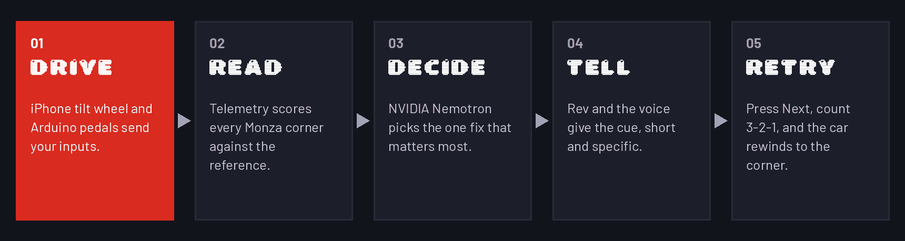
</p>

| Step | What happens |
| --- | --- |
| **01 Drive** | Steer with the iPhone wheel app, gas and brake with the Arduino pedals (or the phone's on-screen pedals). The coach turns both into one virtual Xbox pad for the game. |
| **02 Read** | The coach reads Assetto Corsa's telemetry and scores every corner of Monza against your best: braking point, apex speed, lock-ups, wheelspin, wheels off, time lost. |
| **03 Decide** | NVIDIA Nemotron writes one specific action for that corner. A validator checks every number against the data; if the model is slow or wrong, a rules coach answers instead. |
| **04 Tell** | Rev shows the cue in a speech bubble over the game and the voice says it on the next straight, never mid-corner. |
| **05 Retry** | Tap **Next** on the phone: the car rewinds to the approach of that corner and you try it again. |

<p align="center">
  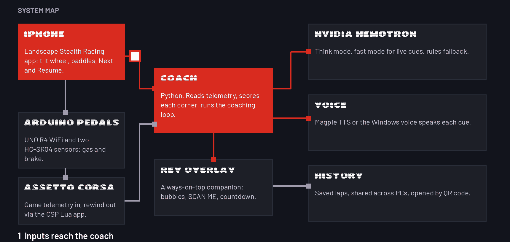
</p>

---

## Meet Rev

<p align="center">
  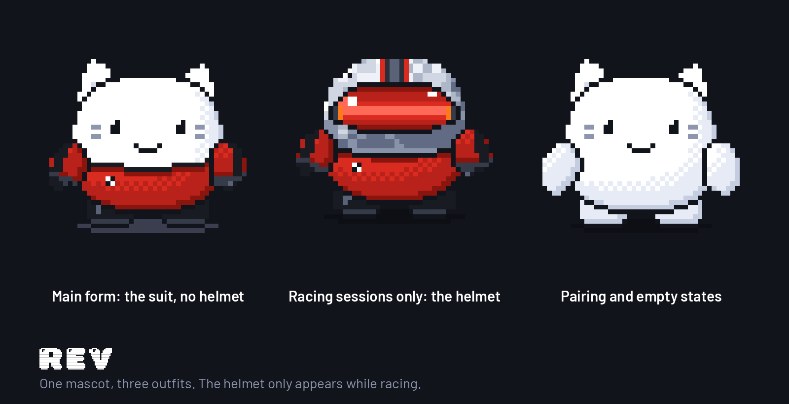
</p>

Rev sits in the bottom-right corner of the game. He shows a **SCAN ME** QR until your phone connects, puts his helmet
on when you drive, reacts to lock-ups and slides, and shows the coach's cue as a short bubble: what happened in bold,
what to do underneath. The voice carries the rest, so the screen stays clear. He never takes focus from the game.

<p align="center">
  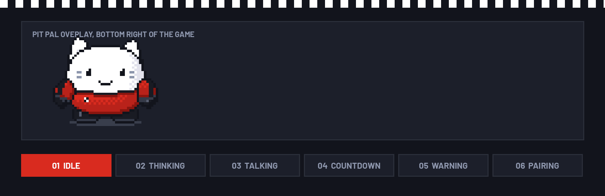
</p>

Hover him for **Accept / Resume / Mute**, click for the details card, right-click for the menu; **Quit Rev** ends the session.

---

## Coaching and retries

<p align="center">
  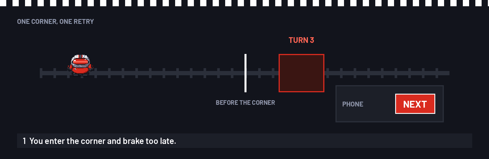
</p>

- **What it catches:** wheels off, spins, lock-ups, wheelspin, braking too early or too late, a slow apex, time lost.
- **What it says:** one cue per mistake, in three parts: the corner, what happened with one number, and one action at a
  brake board, a kerb or the apex. *"Rettifilo: you braked 14 m late, 0.4 s lost. Brake at the 100 board."*
  It never repeats the same advice twice in a row; Rev's quick reactions (*"Easy on throttle."*) are spoken too.
- **The retry:** tap **Next** within the countdown and the car rewinds to the approach of that corner (rolling
  checkpoints saved by a Custom Shaders Patch Lua app), after a **3-2-1** on Rev's overlay. Skip it and you just keep driving.
- **Crashes and stuck cars:** hit a barrier hard, or end up stopped off the track for about five seconds, and you get the
  same offer: *"Crashed. Press Next to rewind to just before it."* Same Next button, same 3-2-1, no walking the car back.
- **The AI:** NVIDIA Nemotron 3.5 Lightning, self-hosted on an H100 (vLLM on Brev) or through NVIDIA's hosted API.
  Fast mode writes the live cue in about a second; think mode does the deeper look; with no AI at all, the rules coach
  still coaches. The voice is NVIDIA Magpie TTS or the Windows voice.

---

## The rig

| Part | What it does |
| --- | --- |
| **iPhone wheel** ([`phone/`](phone)) | Tilt to steer, paddle shifters, on-screen pedals, the **Next** button for retries, pairing by QR. |
| **Arduino pedals** ([`hardware/`](hardware)) | An UNO R4 WiFi with two ultrasonic sensors for gas and brake, calibrated on the game PC, with a fail-safe that releases a pedal if its sensor goes quiet. |
| **Game PC** | Assetto Corsa with Content Manager and Custom Shaders Patch, the coach, Rev, and the rewind app ([`csp/nomadsim_reset`](csp/nomadsim_reset)). |
| **History** | Laps saved locally and, optionally, shared across PCs ([docs/HISTORY.md](docs/HISTORY.md), [docs/SPACETIMEDB.md](docs/SPACETIMEDB.md)). |

---

## Quick start

On the Windows game PC, with Assetto Corsa, Content Manager and Custom Shaders Patch installed:

```powershell
git clone https://github.com/Azrkiel/obsidian-hackutd-2026.git
cd obsidian-hackutd-2026
uv sync --system-certs
.\PitPal.bat
```

Start Assetto Corsa first (borderless or windowed, so Rev can sit on top), then run `PitPal.bat`. Scan Rev's QR with
the app and drive. Everything else (the rewind app, the pedals, Nemotron, pairing, cloud history, troubleshooting) is
in the **[setup guide](SETUP.md)**.

---

## Demo in 3 minutes

1. Click the **Pit Pal** shortcut (make it once with `scripts/make_shortcut.ps1`, then pin it to the taskbar: [SETUP.md, Part E](SETUP.md#part-e-run-it)). Rev appears with a QR code; scan it in the app and he says **Connected.**
2. Drive Monza in the Mazda Miata. Brake late into Turn 1.
3. On the straight, Rev and the voice: *"Rettifilo: you braked 14 m late, 0.4 s lost. Brake at the 100 board."*
4. Tap **Next** on the phone: the car is back before the corner. Try again: **Clean.** or **Not yet.**
5. Floor it out of Lesmo 2: *"Easy on throttle."*

---

## Under the hood

```text
coach/        the coach: telemetry, corner scoring, retry offers, voice, dashboard, phone receiver
engine/       Nemotron decision ladder, validator, rules coach, drills
pitpal/       Rev, the overlay, and the Pit Pal brand assets
phone/        the iPhone wheel app (SwiftUI)
hardware/     Arduino pedal sketch
csp/          the Custom Shaders Patch rewind app (rolling checkpoints)
bridge/       standalone phone + pedals receiver (the coach has its own built in)
scripts/      Brev and the Nemotron tunnel, the shortcut, the retry watcher, history setup
spacetime*/   optional shared race history (SpacetimeDB); history-viewer/ is its web viewer
docs/         reference, pairing, overlay, history; docs/img holds every image in this README
```

The rewind app's folder name, `nomadsim_reset`, is a historical name kept on purpose (it is copied by name into the game). The full engine,
coach and cloud reference is [docs/REFERENCE.md](docs/REFERENCE.md).

---

## In action

| | |
| --- | --- |
| 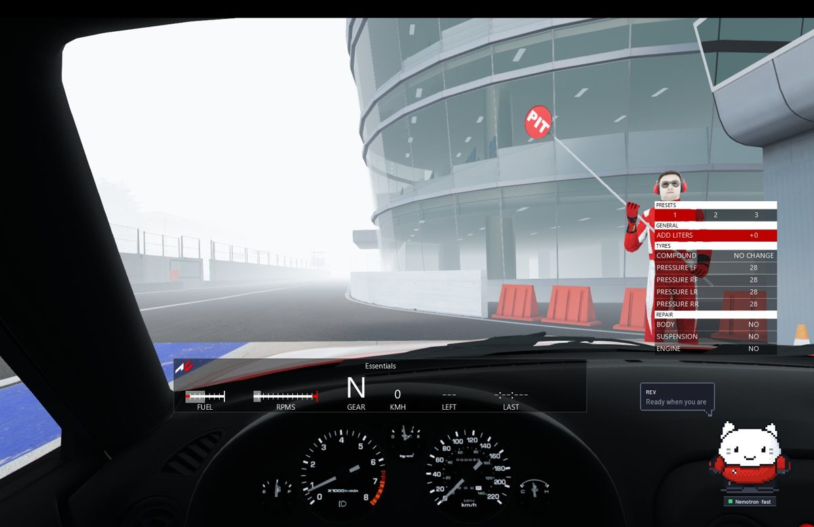 **Pit lane:** Rev is ready and Nemotron is connected. | 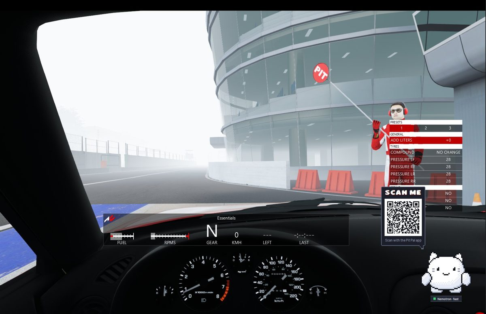 **Pairing:** scan the QR in the pit lane. |
| 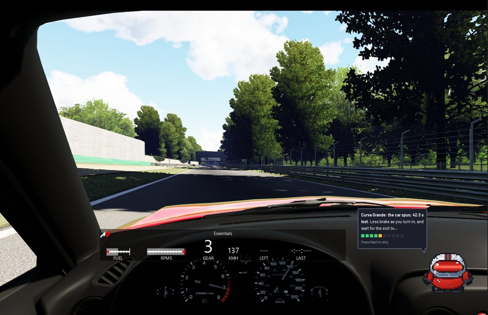 **A cue:** the car spun, 42.3 s lost. Press Next to retry. | 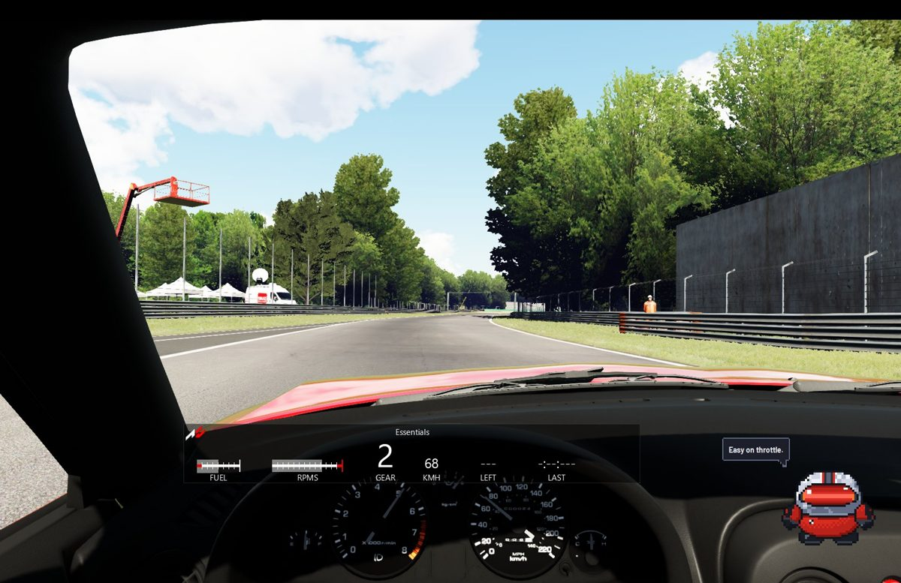 **A quick reaction:** *"Easy on throttle."* |

<p align="center">
  
  
</p>

## Team Obsidian

| | |
| --- | --- |
| **Keven** | iPhone app, input receiver, pairing |
| **Kevin** | engine, Nemotron, voice and history |
| **Dhanush** | game PC, CSP rewind app, pedal tuning, Rev overlay |
| **Will** | Arduino pedals |

<p align="center">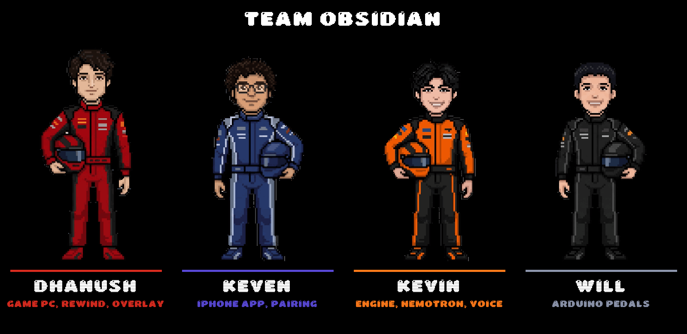</p>

## License and credits

Code: [MIT](LICENSE). Rev, the Pit Pal logos, wordmark and app icon are the team's brand assets and are not licensed
for reuse. Assetto Corsa belongs to Kunos Simulazioni; NVIDIA, Nemotron, Apple and iPhone belong to their owners; this
project is not affiliated with or endorsed by them. Fonts, the QR encoder and other third parties: [NOTICE.md](NOTICE.md).
Security and secrets: [SECURITY.md](SECURITY.md); every setting the code reads: [.env.example](.env.example).

---

<div align="center">

<picture>
  <source media="(prefers-color-scheme: dark)" srcset="docs/img/logo-long-on-dark.png">
  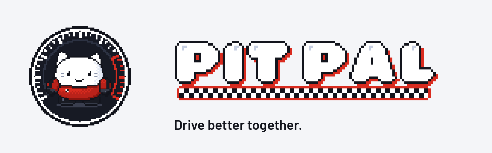
</picture>

**[github.com/Azrkiel/obsidian-hackutd-2026](https://github.com/Azrkiel/obsidian-hackutd-2026)** · HackUTD 2026

</div>
