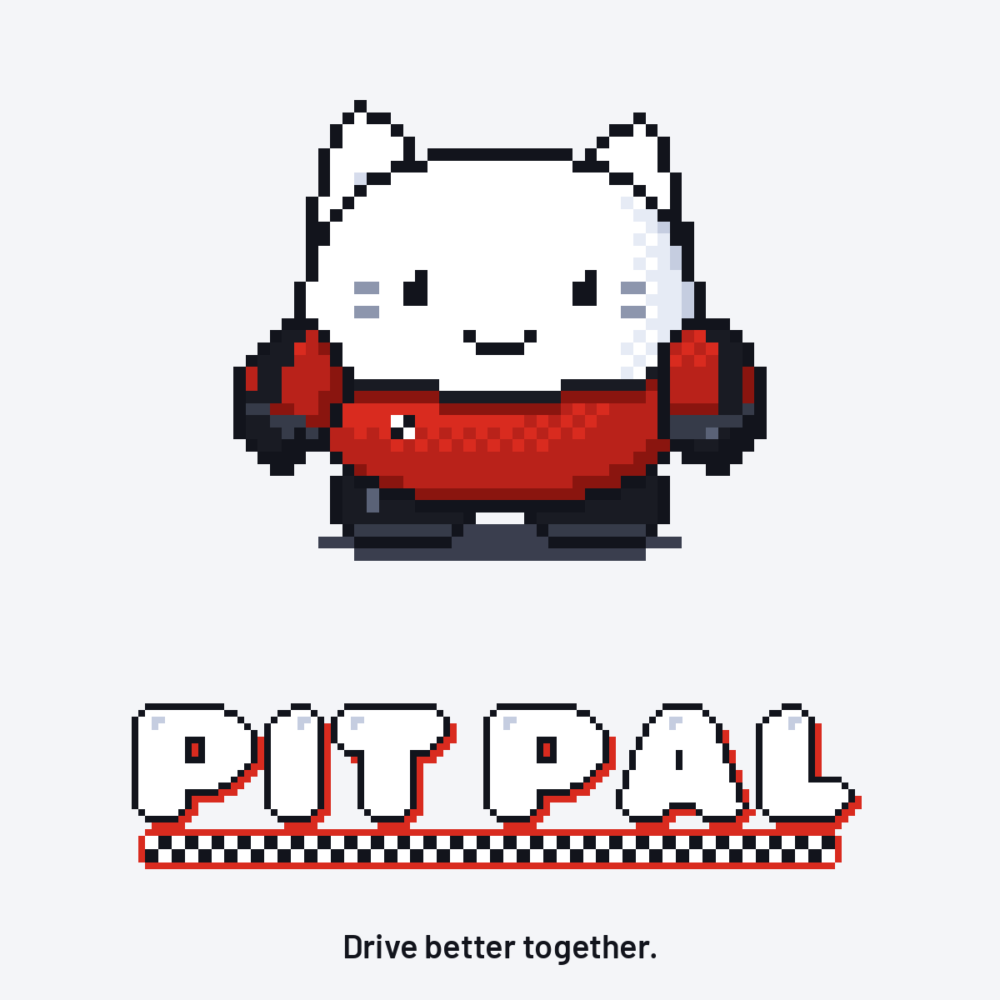
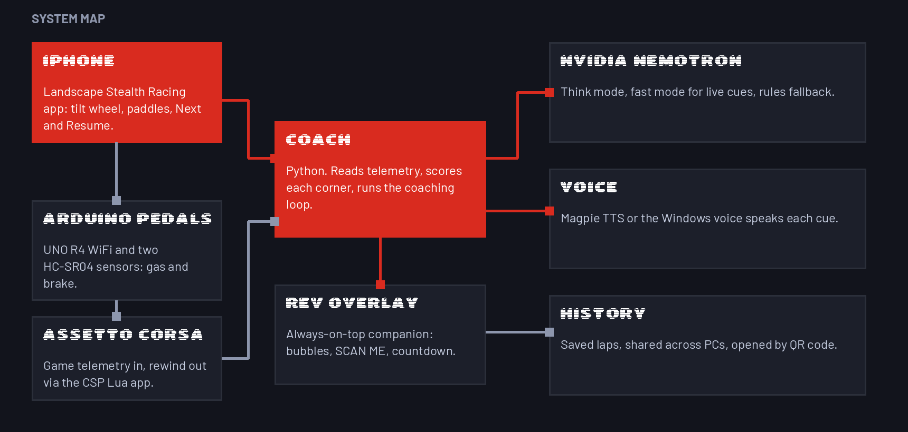
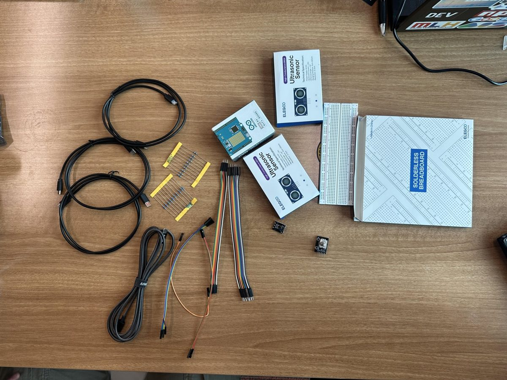
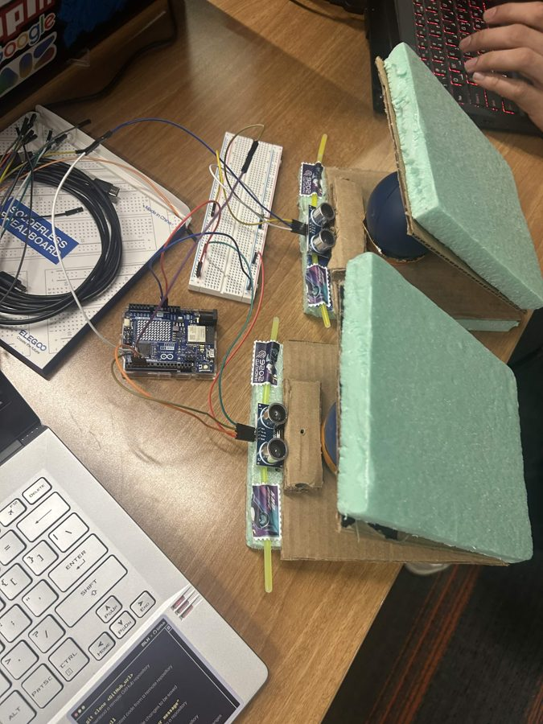
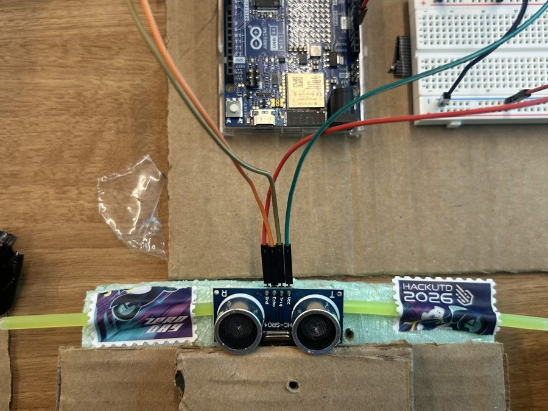
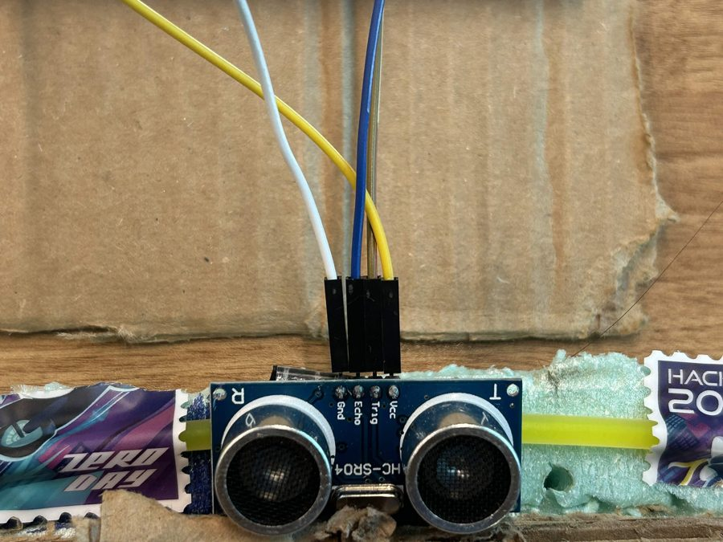
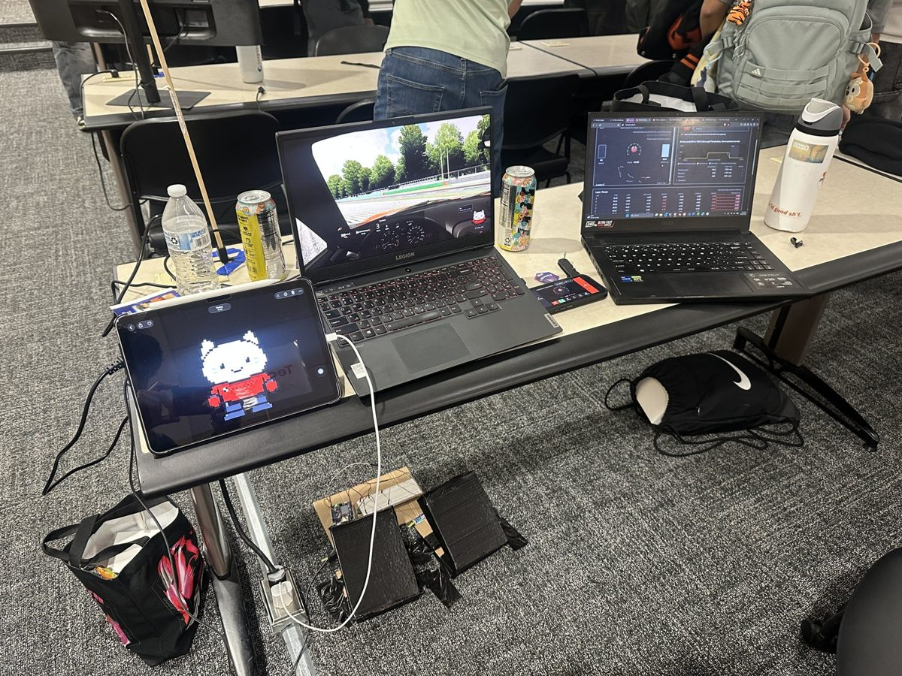
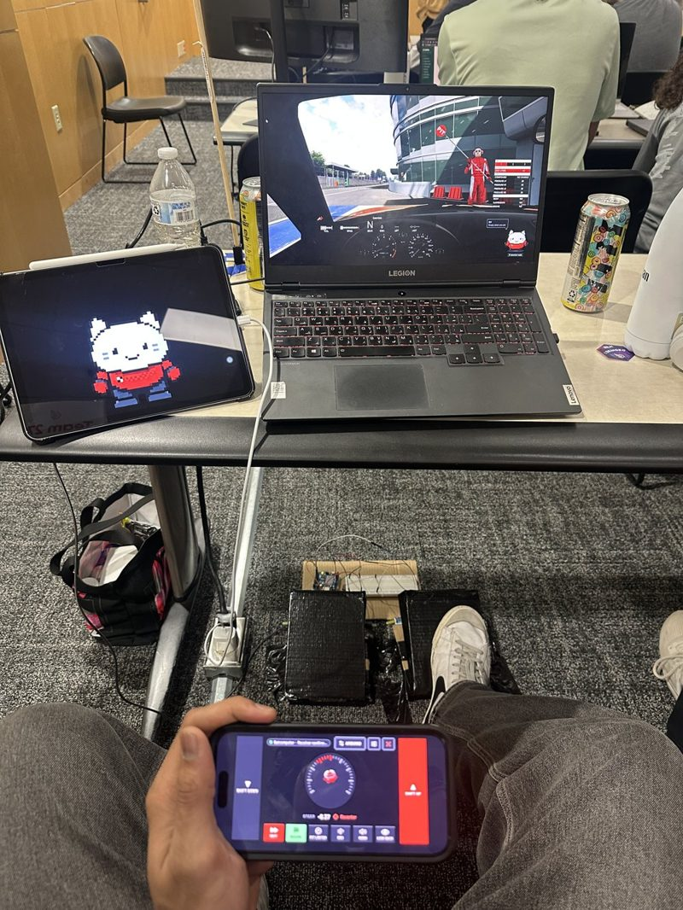

<div align="center">

<picture>
  <source media="(prefers-color-scheme: dark)" srcset="docs/img/logo-stacked-on-dark.png">
  
</picture>

# Setup guide

Build the pedals, set up the game PC and the iPhone wheel, pick an AI, and drive. Hardware and software, start to finish.
Allow an afternoon for a first build: the pedals take the longest, the software about 30 minutes.

**[github.com/Azrkiel/obsidian-hackutd-2026](https://github.com/Azrkiel/obsidian-hackutd-2026)** · [Back to the README](README.md)

</div>

---

## What you are building

<p align="center">
  
</p>

| Part | What it is | Needed for | Section |
| --- | --- | --- | --- |
| **Pedals** | An Arduino with two ultrasonic sensors that measure how far each pedal is pressed | real gas and brake (optional: the phone has on-screen pedals) | [Part A](#part-a-build-the-pedals) |
| **Game PC** | Windows, Assetto Corsa, the coach, Rev and the rewind app | everything | [Part B](#part-b-the-game-pc) |
| **iPhone wheel** | The app: tilt to steer, paddles, the **Next** button | steering and retries | [Part C](#part-c-the-iphone-wheel) |
| **AI** | NVIDIA Nemotron (Brev H100 or NVIDIA's hosted API) | the written coaching cues (without it a rules coach answers) | [Part D](#part-d-pick-an-ai) |
| **Run it** | `PitPal.bat`, pairing, a first lap | everything | [Part E](#part-e-run-it) |

Shopping list for the whole project: a Windows PC that runs Assetto Corsa, an iPhone, and (optional) the pedal parts below.
Jump to [troubleshooting](#part-g-troubleshooting) at any time.

---

## Part A: Build the pedals

Optional but the best part. Skip to [Part B](#part-b-the-game-pc) if you only want to drive with the phone's on-screen pedals.

### A1. How the pedals work

Each pedal has an **HC-SR04 ultrasonic sensor** under it. The sensor sends a short ultrasonic pulse at the underside of the
pedal and times the echo, which gives the **distance to the pedal in centimetres**. Pressing the pedal shortens that distance.
The Arduino turns the distance into a number from **0 (released) to 1000 (floored)** and prints a line `gas,brake` about
90 times a second over USB. The coach reads those lines and passes them to the game as the right trigger (gas) and the
left trigger (brake) of a virtual Xbox controller.

```text
 pedal up            pedal pressed
   ____                ____
  |____| pedal         |____|        <- flat reflector under the pedal
    |                    |
    |  ~9 cm             |  ~4 cm    <- distance the sensor measures
   [HC-SR04]            [HC-SR04]
```

It measures **position, not pressure**: the number says how far the pedal is down, not how hard you push.

### A2. Parts

<p align="center">
  
</p>

| Qty | Part | Notes |
| --- | --- | --- |
| 1 | **Arduino UNO R4 WiFi** | 5 V logic, native USB. The sketch is written and tested for this board. |
| 2 | **HC-SR04 ultrasonic sensor** | One for gas, one for brake. The 5 V version with 4 pins: VCC, TRIG, ECHO, GND. |
| 1 | **Solderless breadboard** | Half-size is plenty. Its + and - rails share the Arduino's 5 V and GND with both sensors. |
| 10 | Jumper wires | Male-to-male for the Arduino and the breadboard rails, male-to-female onto the sensor pins. |
| 2 | Door hinges | One per pedal: the pivot. Superglued into the cardboard base. |
| 2 | Compression stress balls | One under each pedal. They push it back up and give it some resistance. |
| | Foam and cardboard | Cardboard base plus a thick foam slab as the pedal plate: soft and comfortable under the foot. |
| 1 | USB cable | Must carry data (not charge-only), long enough to reach the PC. |

Tools: a screwdriver or hot-glue gun, a ruler (you will measure distances in centimetres), and a computer to flash the board.

### A3. Wiring

Both sensors take power from the breadboard's **+ (5 V)** and **- (GND)** rails. The four signal wires go **straight from the Arduino to the sensors**.
That is 8 connections at the sensors and **10 jumper wires** in all:

1. **Arduino 5V** to the breadboard **+ rail**, and **Arduino GND** to the **- rail** (2 wires).
2. Each sensor's **VCC** to the **+ rail** and its **GND** to the **- rail** (4 wires).
3. Each signal **straight from the Arduino pin to the sensor pin** (4 wires).

| Sensor | Sensor pin | Goes to |
| --- | --- | --- |
| **Gas** | VCC | + rail (5 V) |
| | GND | - rail (GND) |
| | TRIG | Arduino **D4** |
| | ECHO | Arduino **D5** |
| **Brake** | VCC | + rail (5 V) |
| | GND | - rail (GND) |
| | TRIG | Arduino **D2** |
| | ECHO | Arduino **D3** |

```text
 ARDUINO UNO R4 WiFi        BREADBOARD (power rails)         HC-SR04 SENSORS
 +--------------+     +----------------------+          +--------------------+
 |          5V  |-----| + rail (red)  -------|--------->| Gas    VCC         |
 |         GND  |-----| - rail (blue) -------|--------->| Gas    GND         |
 |              |     |                      |          |                    |
 |              |     | + rail  -------------|--------->| Brake  VCC         |
 |              |     | - rail  -------------|--------->| Brake  GND         |
 |              |     +----------------------+          |                    |
 |          D4  |---------------------------------------->| Gas    TRIG     |
 |          D5  |---------------------------------------->| Gas    ECHO     |
 |          D2  |---------------------------------------->| Brake  TRIG     |
 |          D3  |---------------------------------------->| Brake  ECHO     |
 +--------------+                                         +-----------------+
```

The Arduino has one 5 V pin, which is why the breadboard rails are there: one wire in, a wire out to each sensor.
On the sensor header the pins read **Gnd, Echo, Trig, Vcc** left to right (see the photos in [A4](#a4-mount-the-sensors)).
Double-check VCC and GND before you plug in USB: reversed power can damage a sensor. The diagram on the
[website](https://pitpal-site.vercel.app/hardware) lights up each wire as you hover its row. Full hardware reference:
[docs/HARDWARE.md](docs/HARDWARE.md).

### A4. Mount the sensors

**How ours is built.** Each pedal swings on a **door hinge** superglued into a cardboard base, springs back off a **compression stress ball**
under it, and has a thick **foam slab** on top so the brake feels soft and comfortable. Each HC-SR04 sits on a strip of foam facing the
underside of its pedal.

<p align="center">
  
  
  
</p>

The sketch only needs two things from the mechanics: **a repeatable rest distance** and **enough travel**.

1. **Point each sensor straight up at the middle of its pedal's reflector.** The sensor beam is a cone of roughly 15 degrees,
   so aim it squarely and keep nothing else (cables, a shoe, your leg) inside it.
2. **Rest distance about 9 cm, fully-pressed distance about 4 cm.** That leaves about 5 cm of usable travel per pedal.
   The sensor cannot measure closer than about 2 cm, and the sketch ignores anything under 2 cm, so make sure the pedal
   stops **above 3 cm** at the floor.
3. **Use a flat, hard reflector.** Soft things (a sock, foam, a shoe sole) soak up ultrasound and give noisy readings.
   Put a smooth plate on the underside of each pedal for the sensor to see.
4. **Fix the sensors rigidly.** If a sensor can wobble, every reading wobbles.
5. **Keep the two sensors apart or angled away from each other.** The sketch makes them take turns (a few
   milliseconds apart) so they do not hear each other, but pedals set far apart or beams aimed differently help too.
6. **Make each pedal return to the top by itself** (a spring, rubber or foam under the plate), so rest is the same every time.

Do not worry about getting exactly 9 and 4 cm: you measure your real numbers in [A6](#a6-calibrate).

### A5. Flash the sketch

You need the **Arduino UNO R4 Boards** package once.

**With the Arduino IDE:**
1. Install the Arduino IDE. Open **Tools > Board > Boards Manager**, search **Arduino UNO R4 Boards** and install it.
2. Plug the Arduino into the PC. Choose **Tools > Board > Arduino UNO R4 Boards > Arduino UNO R4 WiFi** and the new **Port**.
3. Open [`hardware/pedals/pedals.ino`](hardware/pedals/pedals.ino) and press **Upload**.

**With `arduino-cli`** (what the team used; run from the repo folder, replace `COM4` with your port):

```powershell
arduino-cli core install arduino:renesas_uno
arduino-cli board list
arduino-cli compile --fqbn arduino:renesas_uno:unor4wifi hardware\pedals
arduino-cli upload -p COM4 --fqbn arduino:renesas_uno:unor4wifi hardware\pedals
```

Check it works: open the Serial Monitor at **115200 baud**. You should see lines like `0,0`; press a pedal and the first (gas)
or second (brake) number climbs towards 1000. **Close the Serial Monitor afterwards**: only one program can use the board's
port, and Pit Pal needs it.

### A6. Calibrate

Every build has its own distances. Measure yours once:

1. In `pedals.ino` set `#define MEASURE 1` and upload. The Serial Monitor now prints distances in centimetres:
   `now 9.4 / 8.8   min ... max ...` (gas / brake).
2. With your feet off, note the **resting** distance of each pedal.
3. Press each pedal **fully to the floor** and note the **smallest** distance it reaches.
4. Edit the two lines near the top of the sketch:

   ```cpp
   const float REST[2]  = {9.2, 8.5};   // [gas, brake] distance with the pedal up
   const float PRESS[2] = {4.0, 3.8};   // [gas, brake] distance with the pedal at the floor
   ```

   Set `REST` to the resting distances (a touch under what you measured) and `PRESS` to the floor distances (a touch **above**
   the smallest reading, so a full stomp reaches 100%). Our rig measured gas about 9.4 cm at rest and 3.6 cm at the floor, brake
   about 8.8 cm and 3.5 cm, and uses the values above.
5. Set `#define MEASURE 0` again and upload. Test with the Serial Monitor: released should read `0`, floored `1000`.

If a pedal never reaches 1000, its `PRESS` is too low (below what the pedal actually reaches): raise it. If it creeps up
while released, its `REST` is too high.

### A7. What the firmware does for you

- **Median of three, then smoothing:** one wild reading cannot move the pedal; smoothing is fast while the pedal moves and
  gentle while it is still.
- **Dead zone and full-scale:** under 3% reads 0, over 97% reads 1000, so a resting foot does not creep and a stomp reaches full.
- **Sensors take turns** (`GAP_MS`, 3 ms) so one does not hear the other's echo.
- **Fail-safe:** if a sensor hears no usable echo for 120 ms (`LOST_MS`), that pedal reads **0** instead of freezing at its last
  value, and the board prints `#lost gas` or `#lost brake` once a second. Pit Pal ignores `#` lines.
- It prints about 90 readings a second at 115200 baud.

### A8. Pedal troubleshooting

| Symptom | Likely cause and fix |
| --- | --- |
| Readings jump around | Soft or angled reflector, or a loose sensor. Use a flat hard reflector and fix the sensor. Raise `GAP_MS` to 4 or 5. |
| Throttle flutters | Something else in the beam. Clear the cone. |
| Never reaches 1000 | `PRESS` is below what the pedal reaches. Re-measure and raise it. |
| Reads 0 and prints `#lost ...` | The sensor hears nothing: check VCC, GND, TRIG and ECHO wires, and that the reflector is within about 60 cm. |
| "Access denied" / port busy | Another program holds the port (Serial Monitor, a second coach). Close it. |
| Port hangs and nothing opens it | Unplug and replug the USB cable once. |

---

## Part B: The game PC

### B1. What you need

- **Windows** PC that runs **Assetto Corsa**, with **Content Manager** and **Custom Shaders Patch** (CSP).
- **Git** and **Python 3.11+** with **[uv](https://docs.astral.sh/uv/)**.
- The **ViGEmBus** driver, so Pit Pal can create the virtual Xbox controller the game reads.

### B2. Content Manager and Custom Shaders Patch

Install Content Manager, point it at your Assetto Corsa folder, then open **Settings > Custom Shaders Patch** and install CSP
(the Lua app system the rewind app runs in). **Always launch the game from Content Manager**: that is what loads CSP.

### B3. ViGEmBus

Install the **ViGEmBus** driver (the *nefarius/ViGEmBus* releases page) and reboot if it asks. It is installed separately and
is not bundled. A virtual "Xbox 360 Controller" appears while Pit Pal runs.

### B4. Get the code

```powershell
git clone https://github.com/Azrkiel/obsidian-hackutd-2026.git
cd obsidian-hackutd-2026
uv sync --system-certs
```

uv owns the project's `.venv`: **never `pip install` into it** (`uv sync` removes anything it did not install). The controller packages
are added per run by `PitPal.bat` (`uv run --with vgamepad --with pyserial`).

### B5. Open the firewall for the phone

The phone talks to the PC over UDP port 5005. In an **administrator** PowerShell:

```powershell
New-NetFirewallRule -DisplayName "Pit Pal UDP 5005" -Direction Inbound -Protocol UDP -LocalPort 5005 -Action Allow
```

### B6. Install the rewind app

The retries rewind the car with a small Custom Shaders Patch Lua app. Copy it into the game (quote the path: it may have spaces):

```powershell
Copy-Item -Recurse csp\nomadsim_reset "<Assetto Corsa folder>\apps\lua\"
```

(`nomadsim_reset` is a historical folder name; it is copied by name, so keep it.) It saves rolling checkpoints while you drive and
loads one when you accept a retry. Offline practice only.

### B7. Set up Assetto Corsa

1. **Video:** Content Manager > Settings > Assetto Corsa > Video: **borderless or windowed**, not fullscreen (fullscreen hides Rev).
2. **Quick Drive preset:** **Practice**, track **Monza**, car **Mazda Miata NA**. Under **Assists** set **Gearbox: Automatic**,
   **Clutch: Automatic**, **ABS On**, **Traction control On**. Save it as a preset (for example `Pit Pal Demo`).
   With a manual gearbox the car stops accelerating at the rev limiter in each gear.
3. **Controls:** Settings > Assetto Corsa > **Controls**: input method **Gamepad**. Set **Speed sensitivity 0%**, **Steering speed
   100%**, **Steering gamma 100%** (the phone already steers like a wheel) and **Save preset**. Leave **Combine with keyboard** on if you
   want the keyboard as a backup.
4. After Pit Pal is running ([Part E](#part-e-run-it)) the Controls page's **Test** shows the right trigger (gas) and left trigger
   (brake) moving as you press the pedals.

---

## Part C: The iPhone wheel

The app lives in [`phone/`](phone) (SwiftUI, Swift 6). **An iPhone app can only be built on a Mac**, so this part needs one. The team built
it with Xcode; the steps below come from the project's own settings, and the troubleshooting list covers what usually goes wrong.

### C1. What you need

- A **Mac with Xcode** (free from the Mac App Store). The project's iOS deployment target is **26.6**, so use an Xcode that includes
  a matching iOS SDK, and an iPhone on a matching iOS version. A free **Apple ID** is enough to run the app on your own phone.
- An **iPhone** and a **USB cable** (a data cable, not charge-only).
- The PC and the iPhone on the **same network**. Campus and venue Wi-Fi often blocks devices from talking to each other: use the iPhone's
  **Personal Hotspot** and join the PC to it.

### C2. Build and install

1. On the Mac, get the code: `git clone https://github.com/Azrkiel/obsidian-hackutd-2026.git`.
2. Open `phone/stealth-racing.xcodeproj` in Xcode. In **Xcode > Settings > Accounts**, add your Apple ID.
3. In the project, select the **stealth-racing** target and open **Signing & Capabilities**. Leave **Automatically manage signing** on and choose
   **your own Team** (the project carries the original team's ID, which will not work for you). If Xcode says the bundle identifier is taken, change
   it to something unique, for example `com.yourname.pitpal`.
4. On the iPhone turn on **Developer Mode** (Settings > Privacy & Security > Developer Mode, then restart the phone). Plug it in, unlock it and tap
   **Trust** if it asks.
5. At the top of Xcode choose your iPhone as the run destination and press **Run** (the play button).
6. The first time, the phone may say the developer is untrusted: Settings > General > **VPN & Device Management** > your Apple ID > **Trust**.
7. Open the app and allow **Local Network** (it must reach the PC) and **Camera** (it scans Rev's QR code).

Hold the phone upright like a wheel, tap **Recenter**, and use **Drive**. Pairing is by scanning the **Scan me** code that Rev shows on the PC.

With a free Apple ID the app **expires after 7 days**: plug the phone in and press Run again. A paid Apple Developer Program membership
lasts longer and allows TestFlight, which lets teammates install the app without a cable.

### C3. If it will not build or connect

| Symptom | Fix |
| --- | --- |
| "Signing requires a development team" or a profile error | Pick your own Team under Signing & Capabilities. |
| "Failed to register bundle identifier" | Change the bundle identifier to a unique one. |
| The iPhone is not listed as a destination | Unlock it, tap Trust, try another cable, and turn on Developer Mode. |
| "Untrusted Developer" on the phone | Settings > General > VPN & Device Management > Trust. |
| It says the iOS version is too old | Update the iPhone, or lower **iOS Deployment Target** in the target's General tab (not tested by us: the app may use newer APIs). |
| The app cannot find the PC | Allow Local Network in iOS Settings > Pit Pal. Add the firewall rule from [Part E](#part-e-run-it) on the PC. Use the same network, or the iPhone's hotspot. |
| The QR scan does nothing | Allow Camera in iOS Settings > Pit Pal. |

### C4. No Mac or no iPhone?

- Ask a teammate who has already installed the app to lend you their phone. You pair it to your PC by scanning Rev's QR code.
- The pedals still work through the Arduino without the app, and Assetto Corsa accepts the keyboard for steering (Part B7 keeps it on as
  a backup). We have not tested a full coaching session without the phone, so treat that as a fallback only.

---

## Part D: Pick an AI

| Option | What you do |
| --- | --- |
| **Nemotron on a Brev H100** | Self-hosted, fastest. See below. |
| **NVIDIA's hosted API** | Set the `NVIDIA_API_KEY` environment variable (from build.nvidia.com). This also turns on the NVIDIA Magpie voice. |
| **None** | Do nothing: the rules coach answers locally. |

Every setting is listed in [`.env.example`](.env.example). Keys go in your environment, never in the repo.

### Nemotron on a Brev H100

1. Make a **Brev** account, install the Brev CLI (inside WSL/Ubuntu on Windows) and `brev login`.
2. Start a GPU box. The startup script installs nothing by hand: it pulls vLLM and serves the model
   `nvidia/NVIDIA-Nemotron-3.5-Lightning-30B-A3B-NVFP4` as `nemotron`:

   ```bash
   brev search                      # see what H100 offers exist and their price per hour
   brev create nomadsim-h100 --provider lambda --gpu-name H100 --min-vram 80 --min-disk 200 --startup-script @scripts/brev_vllm_startup.sh
   ```

   (Keep the name `nomadsim-h100`: the tunnel script uses it. Add `--dry-run` first to preview the offer.) If a provider's login user is
   not `ubuntu`, the script's cache path fails: run it on the box with `sudo` instead.
3. Wait for the model to load (about 10 to 15 minutes the first time): `brev exec nomadsim-h100 "docker logs --tail 5 vllm"` until it prints
   `Application startup complete`.
4. Open the tunnel from the PC to the box and leave it running. It rebuilds itself if the connection drops:

   ```powershell
   wsl -d Ubuntu -- bash -l /mnt/<drive>/<path to repo>/scripts/nemotron_tunnel.sh
   ```

5. Check it: `curl.exe http://localhost:8000/v1/models` lists `nemotron`. `PitPal.bat` finds the tunnel by itself, waits up to
   about 18 seconds for it, and sets the Nemotron settings.

**Cost warning:** a Brev GPU bills by the hour until you delete it (`brev delete nomadsim-h100`). Some offers cannot be stopped,
only deleted, and deleting removes the downloaded model.

---

## Part E: Run it

1. Start **Assetto Corsa** from Content Manager (your preset) in borderless mode and get on track.
2. If you use Nemotron, start the tunnel ([Part D](#nemotron-on-a-brev-h100)) first.
3. **Install the Pit Pal app on your desktop** so it is one click away. Run this once from the repository folder:

   ```powershell
   powershell -ExecutionPolicy Bypass -File scripts\make_shortcut.ps1
   ```

   It puts a **Pit Pal** shortcut with the red **P** icon on your Desktop and in the Start menu. For the taskbar, right-click
   the Desktop shortcut, choose **Show more options**, then **Pin to taskbar** (Windows does not let programs pin themselves).
   It should look like this, next to Assetto Corsa:

   

   From then on, click that icon (or double-click **`PitPal.bat`**) to start Pit Pal.

4. **Rev** appears in the bottom-right corner with a **SCAN ME** QR code. Scan it with the app and he says **Connected.**
   On shared Wi-Fi use `--pairing required` so only a paired phone can drive. Right-click Rev for **New pairing code**.
5. Plug in the pedals before starting: the coach finds the Arduino on its own. Rev warns if a pedal or the phone drops out.
6. Drive Monza. Make a mistake on purpose: a cue appears with a countdown. Tap **Next** on the phone and the car rewinds to before
   the corner so you can try again. **Quit Rev** (right-click) ends the session.

Here is the whole thing set up: the game laptop with Rev on top of Assetto Corsa, the coach dashboard on a second screen, the phone as the wheel and the pedals on the floor.

<p align="center">
  
  
</p>

By hand, the same thing:

```powershell
uv run --with vgamepad --with pyserial python -m coach --telemetry ac --reset udp --inputs --track fixtures/track_monza.json --overlay
```

No game or no hardware to hand? `uv run python -m coach --track fixtures/track_monza.json --telemetry sim --inputs --pad none --arduino off --overlay`
runs the whole loop with a simulated driver. Pairing details: [docs/PAIRING.md](docs/PAIRING.md).

### Tune how it feels

| Option | What it does |
| --- | --- |
| `--gas-gamma 1.3` (default) | Throttle curve: output = pedal^gamma. `1.0` is linear; higher makes the first half of the pedal gentler. |
| `--brake-gamma 1.0` (default) | The same for the brake. |
| `--invert-steer` | Flip the steering direction. |
| `--arduino COM4` / `off` | Pick the pedal port by hand, or turn the pedals off and use the phone's. |

Pass them to `PitPal.bat` (for example `PitPal.bat --gas-gamma 1.0`) or to the `python -m coach` command above.

---

## Part F: Optional extras

- **Shared history:** enroll the PC once and laps are shared across machines:

  ```powershell
  uv run --system-certs --extra cloud python scripts/spacetime_device.py setup --server https://maincloud.spacetimedb.com --database pitpal-history --label game-pc
  uv run --system-certs --extra cloud python scripts/spacetime_device.py status
  ```

  The database owner registers the printed identity. Details: [docs/HISTORY.md](docs/HISTORY.md), [docs/SPACETIMEDB.md](docs/SPACETIMEDB.md).
- **Watch retries live:** `uv run python scripts/watch_retry.py` prints every rewind step.
- **Run the tests:** `uv run pytest -q --deselect tests/test_telemetry.py::test_ac_source_errors_cleanly_off_windows_or_without_ac`
  (that test waits for Assetto Corsa on Windows; `tests/test_ladder.py::test_total_deadline_rules` is timing-sensitive).

---

## Part G: Troubleshooting

| Problem | Fix |
| --- | --- |
| **Rev does not show** | Assetto Corsa is in exclusive fullscreen: switch to borderless or windowed. |
| **The car stops accelerating at 30 to 60 km/h** | Manual gearbox at the rev limiter. Set **Gearbox: Automatic** in the Quick Drive assists. |
| **Badge says "Rules (AI unavailable)"** | The coach only looks for Nemotron when it starts. Start the tunnel, check `curl.exe http://localhost:8000/v1/models`, then restart `PitPal.bat`. |
| **The tunnel keeps dropping** | Run `scripts/nemotron_tunnel.sh`: it rebuilds the connection within seconds. Campus Wi-Fi is the usual culprit. |
| **The phone does not connect** | Same network or the iPhone hotspot, Local Network allowed, firewall open for **UDP 5005**. Right-click Rev, **New pairing code**, scan again. |
| **"Another receiver is running"** | Only one coach or bridge may hold UDP 5005: `PitPal.bat` closes a leftover session itself. |
| **Pedals show "silent" in Pit Pal** | Close the Serial Monitor or any second coach; the port can only be held once. Unplug and replug the USB cable if the port hangs. |
| **No retry offered ("checkpoint unavailable")** | The rewind app is not loaded: launch the game from Content Manager. The coach prints `rolling checkpoints: Lua app connected` when it works. |
| **Steering feels sluggish** | Set steering speed 100%, steering gamma 100% and speed sensitivity 0% in the game's Controls. |
| **The game crashes on exit** | Known Assetto Corsa behaviour; it does not affect driving. Don't quit mid-demo; kill `acs` and relaunch if Content Manager gets stuck. |
| **Ports used** | UDP 5005 phone, TCP 8020 dashboard (`http://127.0.0.1:8020`), UDP 9101 and 9102 rewind app, TCP 8000 Nemotron tunnel. |

Game-PC notes from development: [docs/GAME_PC_NOTES.md](docs/GAME_PC_NOTES.md). Full reference: [docs/REFERENCE.md](docs/REFERENCE.md).

<div align="center">

**[github.com/Azrkiel/obsidian-hackutd-2026](https://github.com/Azrkiel/obsidian-hackutd-2026)** · Drive better together.

</div>
