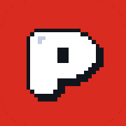

<div align="center">

<picture>
  <source media="(prefers-color-scheme: dark)" srcset="docs/img/logo-stacked-on-dark.png">
  
</picture>

# Setup guide

Everything to get Pit Pal running on a Windows game PC: the coach, Rev, the rewind app, the iPhone wheel,
the pedals and the AI. About 30 minutes end to end.

**[github.com/Azrkiel/obsidian-hackutd-2026](https://github.com/Azrkiel/obsidian-hackutd-2026)** · [Back to the README](README.md)

</div>

---

| Step | What | Needed for |
| --- | --- | --- |
| [1](#1-what-you-need) | What you need | everything |
| [2](#2-install) | Install the coach | everything |
| [3](#3-the-rewind-app) | The CSP rewind app | retries |
| [4](#4-the-iphone-wheel) | The iPhone wheel | steering, Next |
| [5](#5-the-pedals) | The Arduino pedals | optional: real pedals |
| [6](#6-pick-an-ai) | Pick an AI | optional: Nemotron cues |
| [7](#7-start-pit-pal) | Start Pit Pal | everything |
| [8](#8-pair-the-phone) | Pair the phone | steering, Next |
| [9](#9-optional-shared-history) | Shared history | optional |
| [10](#10-run-the-tests) | Run the tests | development |
| [11](#11-troubleshooting) | Troubleshooting | |

---

## 1. What you need

- A **Windows game PC** with **Assetto Corsa**, **Content Manager** and **Custom Shaders Patch** (CSP).
- **Python 3.11+** and **[uv](https://docs.astral.sh/uv/)**, plus **Git**.
- An **iPhone** with the Pit Pal app (built from [`phone/`](phone) in Xcode).
- The **ViGEmBus** driver, so the coach can create the virtual Xbox pad the game reads.
- Optional: the **Arduino pedals** ([`hardware/`](hardware)), an **NVIDIA API key** or a **Brev** H100 for
  Nemotron, and a **SpacetimeDB** database for shared history.

---

## 2. Install

```powershell
git clone https://github.com/Azrkiel/obsidian-hackutd-2026.git
cd obsidian-hackutd-2026
uv sync --system-certs
```

uv owns the project's `.venv`: never `pip install` into it (`uv sync` removes anything it did not install). The
controller packages are added per run by `PitPal.bat` (`uv run --with vgamepad --with pyserial`).

---

## 3. The rewind app

Copy [`csp/nomadsim_reset`](csp/nomadsim_reset) into the game's Lua apps folder:

```powershell
Copy-Item -Recurse csp\nomadsim_reset "<Assetto Corsa folder>\apps\lua\"
```

Always launch the game from **Content Manager** (CSP loads the app). It saves rolling checkpoints while you drive
and loads one when you accept a retry. Offline practice only.

---

## 4. The iPhone wheel

Build and install the app from [`phone/`](phone) with Xcode. Hold the phone like a wheel, tap **Recenter**, and
use **Drive**. The phone and the PC must reach each other: use the iPhone's **Personal Hotspot** if your Wi-Fi blocks
devices from talking to each other, and allow the app **Local Network** access.

---

## 5. The pedals

Optional. An Arduino UNO R4 WiFi with two HC-SR04 sensors: gas on Trig D4 / Echo D5, brake on Trig D2 / Echo D3,
both on 5V and GND. Upload [`hardware/pedals/pedals.ino`](hardware/pedals/pedals.ino); to calibrate, set
`MEASURE 1`, read the distances, then set `REST` and `PRESS` per pedal and upload with `MEASURE 0`.
Plug it in before starting: the coach finds it on its own. If a sensor goes quiet, that pedal releases.

---

## 6. Pick an AI

| Option | How |
| --- | --- |
| **Nemotron on a Brev H100** | Start the box with [`scripts/brev_vllm_startup.sh`](scripts/brev_vllm_startup.sh), then keep the tunnel open: `wsl -d Ubuntu -- bash -l scripts/nemotron_tunnel.sh` (WSL path to the repo). `PitPal.bat` finds it on `localhost:8000`. |
| **NVIDIA's hosted API** | Set `NVIDIA_API_KEY` (also turns on the NVIDIA Magpie voice). |
| **None** | The rules coach runs locally. |

Every setting is listed in [`.env.example`](.env.example). Keys go in your environment, never in the repo.

---

## 7. Start Pit Pal

1. Start Assetto Corsa from Content Manager in **borderless or windowed** mode (fullscreen hides Rev) and get on track.
2. Double-click **`PitPal.bat`**, or make a desktop shortcut with the Pit Pal icon once:
   `powershell -ExecutionPolicy Bypass -File scripts\make_shortcut.ps1`.
3. Rev appears in the bottom-right corner. **Quit Rev** (right-click) ends the session.

The same thing by hand:

```powershell
uv run --with vgamepad --with pyserial python -m coach --telemetry ac --reset udp --inputs --track fixtures/track_monza.json --overlay
```

No game? `uv run python -m coach --track fixtures/track_monza.json --telemetry sim --inputs --pad none --arduino off --overlay`.

---

## 8. Pair the phone

Scan Rev's **SCAN ME** QR code with the app. On shared Wi-Fi, start with `--pairing required` so only a paired phone
can drive. Right-click Rev for **New pairing code**. Protocol details: [docs/PAIRING.md](docs/PAIRING.md).

---

## 9. Optional: shared history

Enroll the PC once and laps are shared across machines:

```powershell
uv run --system-certs --extra cloud python scripts/spacetime_device.py setup --server https://maincloud.spacetimedb.com --database pitpal-history --label game-pc
uv run --system-certs --extra cloud python scripts/spacetime_device.py status
```

The database owner registers the printed identity. Details: [docs/HISTORY.md](docs/HISTORY.md),
[docs/SPACETIMEDB.md](docs/SPACETIMEDB.md).

---

## 10. Run the tests

```powershell
uv run pytest -q --deselect tests/test_telemetry.py::test_ac_source_errors_cleanly_off_windows_or_without_ac
```

That one test waits for Assetto Corsa on Windows; `tests/test_ladder.py::test_total_deadline_rules` is timing-sensitive.

---

## 11. Troubleshooting

| Problem | Fix |
| --- | --- |
| Rev does not show | Assetto Corsa is in exclusive fullscreen: switch to borderless or windowed. |
| The phone does not connect | Same network (or the iPhone hotspot), Local Network allowed, firewall open for **UDP 5005**. |
| "Another receiver is running" | Only one coach or bridge may hold UDP 5005: `PitPal.bat` closes a leftover session itself. |
| No retry offered ("checkpoint unavailable") | The rewind app is not loaded: launch the game from Content Manager; the coach prints `rolling checkpoints: Lua app connected`. Watch retries with `uv run python scripts/watch_retry.py`. |
| The game crashes on exit | Known Assetto Corsa behaviour; it does not affect driving. Don't quit mid-demo. |
| A phone paired with another PC | Right-click Rev, **New pairing code**, and scan again. |
| Ports | UDP 5005 phone, TCP 8020 dashboard (`http://127.0.0.1:8020`), UDP 9101/9102 rewind app, TCP 8000 Nemotron tunnel. |

Game-PC specifics from development: [docs/GAME_PC_NOTES.md](docs/GAME_PC_NOTES.md). Full reference: [docs/REFERENCE.md](docs/REFERENCE.md).

<div align="center">



**[github.com/Azrkiel/obsidian-hackutd-2026](https://github.com/Azrkiel/obsidian-hackutd-2026)** · Drive better together.

</div>
