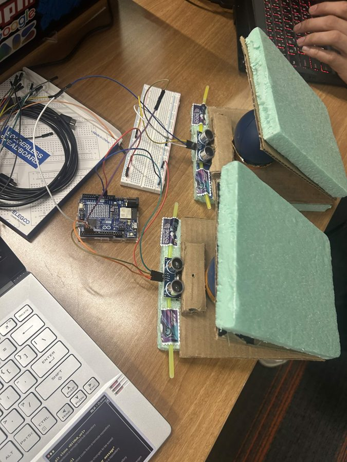
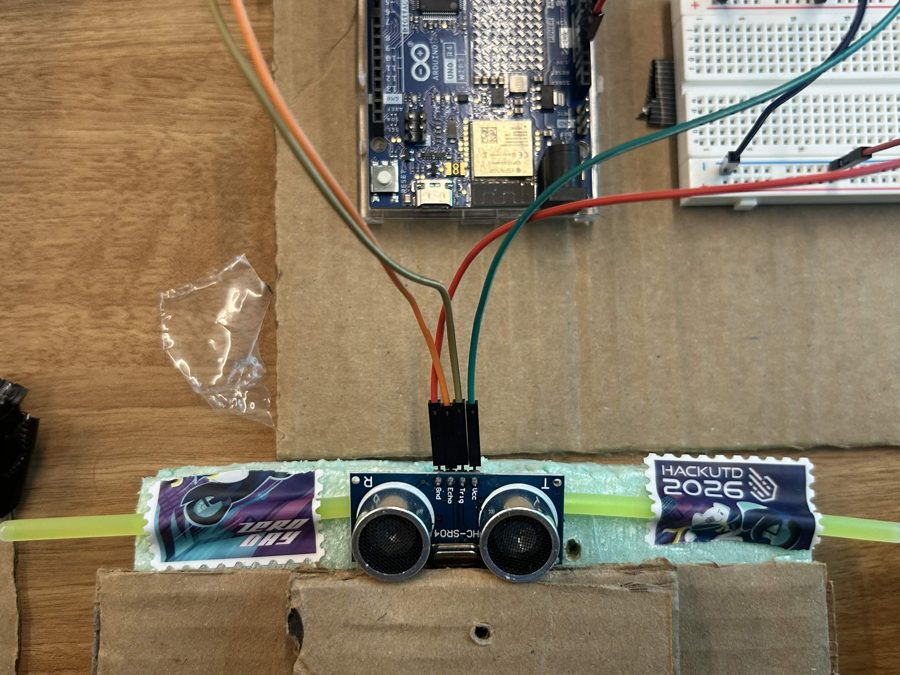
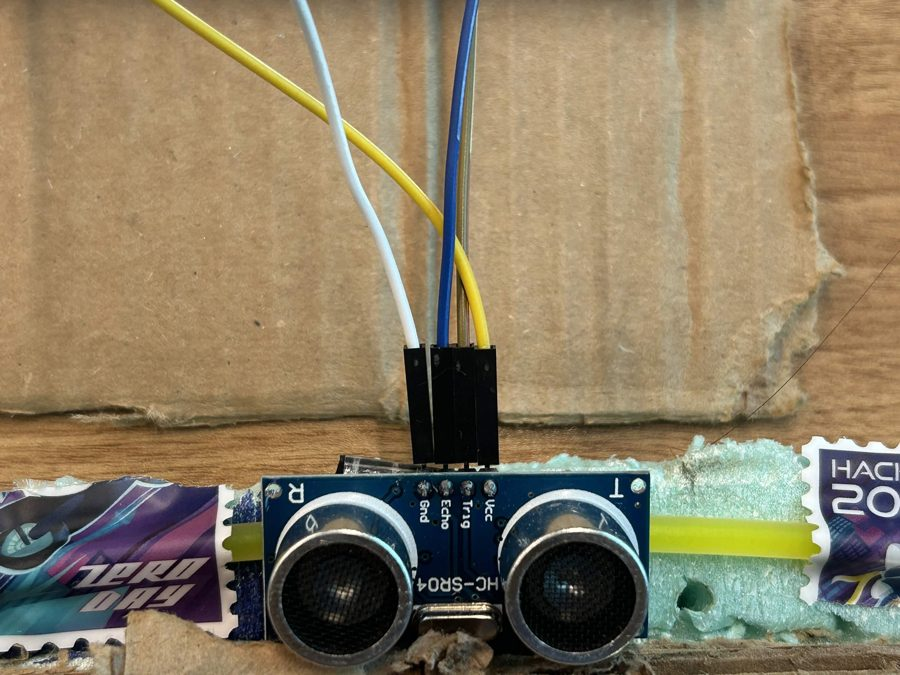

# Pit Pal pedals: hardware, wiring and connection points

DIY gas and brake pedals for Pit Pal (HackUTD 2026, Team Obsidian). Each pedal has an HC-SR04 ultrasonic sensor that measures the
distance to the pedal. An Arduino UNO R4 WiFi filters the readings and sends `gas,brake` over USB serial. The coach on the game PC turns
that into a virtual Xbox 360 controller, which Assetto Corsa reads like any gamepad. Pedals and wiring: Will.

<p align="center">
  
  
  
</p>

## 1. Signal chain

```text
  right foot                 left foot
  [gas pedal]                [brake pedal]
      |                           |
  HC-SR04 (gas)             HC-SR04 (brake)      distance to the underside of each pedal
      +------------+--------------+
                   |
        Arduino UNO R4 WiFi  (hardware/pedals/pedals.ino)
                   |  USB serial, 115200 baud, lines "gas,brake" (each 0..1000)
                   v
        Game PC: the coach with --inputs   (PitPal.bat does this)
                   |  vgamepad + ViGEmBus
                   v
        virtual Xbox 360 controller: right trigger = gas, left trigger = brake
                   v
        Assetto Corsa --> shared memory --> Pit Pal coach
```

Steering does not go through the Arduino: it comes from the iPhone over UDP port 5005 and is mixed into the same virtual controller.

## 2. How the pedals are built

- **Pivot:** a door hinge per pedal, superglued into a cardboard base, so the pedal swings down like a door.
- **Spring-back:** a compression stress ball under each pedal pushes it back up and gives some resistance.
- **Feel:** cardboard plus a thick foam slab as the pedal plate: softer and more comfortable, especially for the brake.
- **Sensor:** each HC-SR04 sits on a strip of foam and faces the underside of its pedal. Pressing the pedal shortens the distance.
- Right pedal is gas, left pedal is brake.

## 3. Bill of materials

| Qty | Part | Notes |
| --- | --- | --- |
| 1 | Arduino UNO R4 WiFi | 5 V logic, powered over USB |
| 2 | HC-SR04 ultrasonic sensor | 4 pins: VCC, Trig, Echo, GND (the header reads Gnd, Echo, Trig, Vcc) |
| 1 | Solderless breadboard | Its + and - rails share 5 V and GND between the sensors |
| 10 | Jumper wires | 2 from Arduino 5V/GND to the rails, 4 from the rails to the sensors, 4 signal wires from the Arduino to the sensors |
| 1 | USB cable | A data cable, not charge-only |
| 2 | Door hinges | The pedal pivots, superglued into the cardboard |
| 2 | Compression stress balls | Spring-back and resistance |
| | Foam, cardboard, superglue | Pedal plates and base |

No resistors, capacitors or level shifters, and no soldering: the UNO R4 is 5 V logic, so the sensor's 5 V echo is safe.

## 4. Wiring

| Net | Gas sensor | Brake sensor | Goes to |
| --- | --- | --- | --- |
| +5 V | VCC | VCC | breadboard + rail (fed from Arduino 5V) |
| GND | GND | GND | breadboard - rail (fed from Arduino GND) |
| Gas trigger | Trig | | Arduino D4 |
| Gas echo | Echo | | Arduino D5 |
| Brake trigger | | Trig | Arduino D2 |
| Brake echo | | Echo | Arduino D3 |

Pin numbers are set in the firmware: `TRIG[2] = {4, 2}` and `ECHO[2] = {5, 3}` (index 0 is gas, index 1 is brake). If you move a wire, change the
number there too. Avoid D0 and D1. If the pedals ever work backwards, check this first. Each HC-SR04 draws about 15 mA, so USB power is enough.

## 5. Calibration (latest, from the sketch)

| Pedal | Released | Fully pressed | Travel |
| --- | --- | --- | --- |
| Gas | 9.2 cm | 4.0 cm | about 5.2 cm |
| Brake | 8.5 cm | 3.8 cm | about 4.7 cm |

`REST = {9.2, 8.5}` and `PRESS = {4.0, 3.8}` (gas was last re-measured on the game PC: rest 9.4, full press 3.9). The sensor is reliable above about 3 cm
with about 0.3 cm resolution, so a pedal has roughly 15 to 20 distinct positions: a hardware limit. Keep the target flat and solid, and recalibrate
after a bump (`#define MEASURE 1`, read the distances, set `REST` and `PRESS`, then `MEASURE 0`).

## 6. Firmware summary (`hardware/pedals/pedals.ino`)

| Setting | Value |
| --- | --- |
| Baud rate | 115200 |
| Pins | `TRIG = {4, 2}`, `ECHO = {5, 3}` (gas, brake) |
| Gap between pings | `GAP_MS = 3` (raise to 4 or 5 if readings spike) |
| Filter | Median of 3, then an adaptive average: 0.8 when the reading moves more than 1.0 cm, otherwise 0.3 |
| Dead zones | Under 3% reads 0, over 97% reads 1000 |
| Fail-safe | No good echo for `LOST_MS = 120` ms: that pedal reads 0 (never freezes) and the board prints `#lost gas` or `#lost brake` |
| Output | `gas,brake` as integers 0 to 1000, about 90 lines per second |

Sensors ping one after the other, never together, to avoid crosstalk. A reading becomes a value as `(REST - distance) / (REST - PRESS)`, limited to 0 to 1.

## 7. Connection points

| # | From | To | Medium | What crosses |
| --- | --- | --- | --- | --- |
| 1 | Each pedal | Its HC-SR04 | Ultrasound | Distance to the pedal |
| 2 | HC-SR04 Trig/Echo | Arduino D4/D5 (gas), D2/D3 (brake) | Jumper wires | Trigger pulse out, echo pulse back |
| 3 | Arduino | Game PC | USB serial, 115200 baud | Lines `gas,brake` |
| 4 | Game PC receiver | Virtual Xbox 360 pad | vgamepad / ViGEmBus | Gas on the right trigger, brake on the left |
| 5 | iPhone | Game PC receiver | UDP port 5005, same network | Steering and phone buttons |
| 6 | Virtual pad | Assetto Corsa | Windows game controller | Throttle, brake, steering |
| 7 | Assetto Corsa | Pit Pal coach | Shared memory | Gas, brake, speed, position |

**Serial protocol:** 115200 baud, 8N1, one line per update `<gas>,<brake>` (for example `412,0`), no header or checksum. Lines starting with `#` are
ignored. The receivers find the Arduino by USB vendor ID `0x2341` or a port description containing "arduino", "ch340" or "usb serial" (on some PCs COM3 and
COM5 are Bluetooth, not the Arduino). If `MEASURE` was left at 1 the receiver sees no pedals.

**Run only one receiver at a time.** The coach (`PitPal.bat`) already reads the pedals. `hardware/bridge.py` is a standalone tester: two receivers fight over
UDP 5005, the COM port and the virtual pad, and the game sees two controllers. In Assetto Corsa bind throttle to the right trigger, brake to the left
trigger and steering to the left stick.

## 8. Bring-up checklist

1. **Wiring:** check the table in section 4 against the rig, and 5V and GND on both sensors.
2. **Raw serial:** upload `pedals.ino`, open the Arduino Serial Monitor at 115200: `0,0` at rest, the first number rises to 1000 on the right pedal, the second on the left.
3. **Close the Serial Monitor:** only one program can use the port.
4. **Receiver:** start Pit Pal and check it reports the Arduino as connected and the numbers follow the pedals.
5. **Windows:** "Set up USB game controllers" should show the Xbox 360 controller responding.
6. **Game:** check the controller and bindings on Assetto Corsa's Controls page.
7. **Coach:** the dashboard's gas and brake should match what you press.

| Symptom | Likely cause | Fix |
| --- | --- | --- |
| Pedals swapped | Pin map or bindings | Check section 4 and the Assetto Corsa bindings |
| One pedal stuck at 0 | Sensor lost its echo (it prints `#lost`) | Reseat the sensor, keep it above 3 cm, check the wiring |
| Never reaches 100% | `PRESS` too low | Re-measure and raise `PRESS` by about 0.3 cm |
| Flickers at rest | Spikes up to about 1 cm | Raise `GAP_MS` to 4 or 5 |
| Laggy brake | Filter | Lower the 1.0 cm fast threshold to 0.6 |
| No Arduino | Port busy, wrong port, `MEASURE` left at 1 | Close the Serial Monitor, check the COM port |
| The game sees two controllers | Two receivers running | Stop one |

## 9. Not verified

End-to-end latency from foot to game has not been measured, and pedal feel has not been compared with a real pedal. Whether the board resets when the
receiver opens the port was not checked.
